<div align="center">

<picture>
  <source media="(prefers-color-scheme: dark)" srcset="docs/assets/logo-dark.svg">
  
</picture>

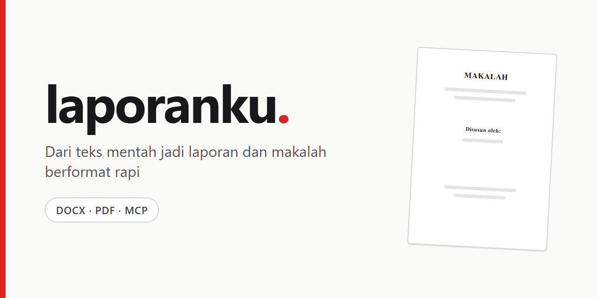

**Dari teks mentah menjadi makalah dan laporan berformat rapi, siap dikumpulkan.**


</div>

## Tentang

Laporanku membantu pelajar (SMA/SMK) dan mahasiswa merapikan makalah dan laporan tanpa berkutat dengan format Word. Pengguna memberi konten (tempel teks, unggah file, atau isi form topik). Sistem mengubahnya menjadi dokumen terstruktur (JSON), lalu membangun file **DOCX yang masih bisa diedit** dan **PDF** dengan format baku: cover, kata pengantar, daftar isi, nomor halaman romawi lalu angka, bab dan subbab bernomor otomatis, serta daftar pustaka.

Aturan utama: **jalur tempel dan unggah tidak boleh mengarang isi.** AI hanya memberi label struktur (judul bab, subbab, paragraf, list) pada paragraf asli. Teks dokumen selalu diambil dari input pengguna.

Spesifikasi lengkap ada di [`docs/PRD.md`](docs/PRD.md) (Bahasa Indonesia).

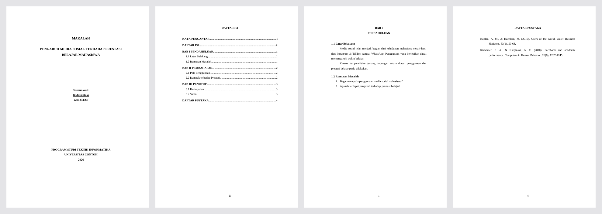

## Status proyek

Proyek ini **masih dalam pengembangan** (branch `feat/phase-1-foundation`). Berdasarkan tracker task, sekitar 29 dari 45 task sudah selesai.

**Sudah berjalan**

- Autentikasi (Fortify): login, registrasi, verifikasi email, 2FA, passkey, pengaturan akun.
- Pengguna tamu ("Coba tanpa daftar") yang naik menjadi akun saat registrasi, dengan dokumen tetap milik akun yang sama.
- Membuat dokumen dari teks tempel, unggahan `.md`/`.txt`/`.docx`, atau form topik dengan data pokok (laporan praktikum dan laporan PKL/Prakerin).
- Jenjang Mahasiswa, SMA, dan SMK; label cover mengikuti jenjang.
- Editor blok (TipTap) dengan simpan otomatis, drag-and-drop bab/subbab, undo/redo.
- Preview kertas A4 (paged.js) dan "Preview akurat" berupa PDF asli.
- Ekspor DOCX (PHPWord) dan PDF (Gotenberg), lewat tautan bertanda tangan.
- Paket Free dan Pro dengan kuota dokumen.
- Pembayaran Midtrans **sandbox** dengan webhook terverifikasi.
- Server MCP agar agen AI (Claude Desktop, Cursor, dan sejenisnya) bisa membuat dan mengekspor dokumen.

**Belum selesai**

- Pipeline AI penuh. `Structurer` (pelabelan paragraf) dan job-nya sudah ada dan teruji dengan fake provider, tetapi belum tersambung ke form dan belum diuji dengan model sungguhan. Pembuatan outline dan penulisan per bab belum dikerjakan.
- Format sitasi dan pencarian referensi, template custom per kampus dan logo cover, blok tabel dan gambar, halaman pengesahan dan abstrak.
- Midtrans production, fitur AI tambahan, kolaborasi dan riwayat versi.
- Deploy demo.
- Hasil DOCX belum diperiksa di MS Word asli (baru LibreOffice/Gotenberg).

## Fitur

| Fitur | Keterangan |
|---|---|
| Beberapa jalur input | Tempel teks, unggah `.md`/`.txt`/`.docx`, atau form topik |
| Struktur otomatis | Pembersih teks dan pemetaan heading, ditambah pelabelan AI untuk teks tanpa heading |
| Editor blok | TipTap, simpan otomatis, urutkan bab dengan seret-lepas, undo/redo |
| Format baku | Times New Roman 12, spasi 1,5, margin 4-3-3-3, penomoran bab otomatis |
| DOCX dan PDF | DOCX bisa diedit; PDF dibuat dari DOCX yang sama sehingga isinya identik |
| Mode terang dan gelap | Tema merah, Flux UI (versi gratis) |
| Server MCP | Lima tool untuk agen AI, autentikasi token |

<table>
  <tr>
    <td>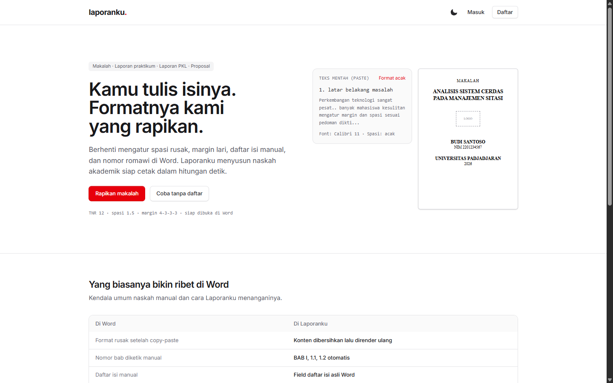</td>
    <td>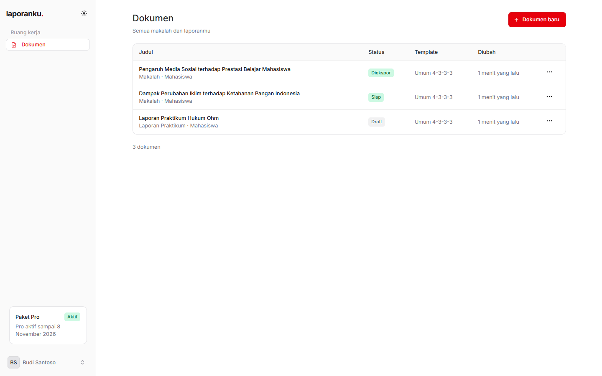</td>
  </tr>
  <tr>
    <td>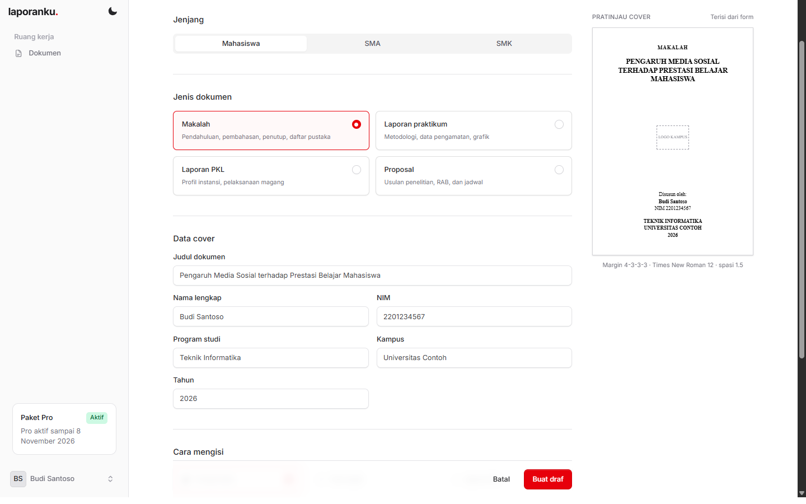</td>
    <td>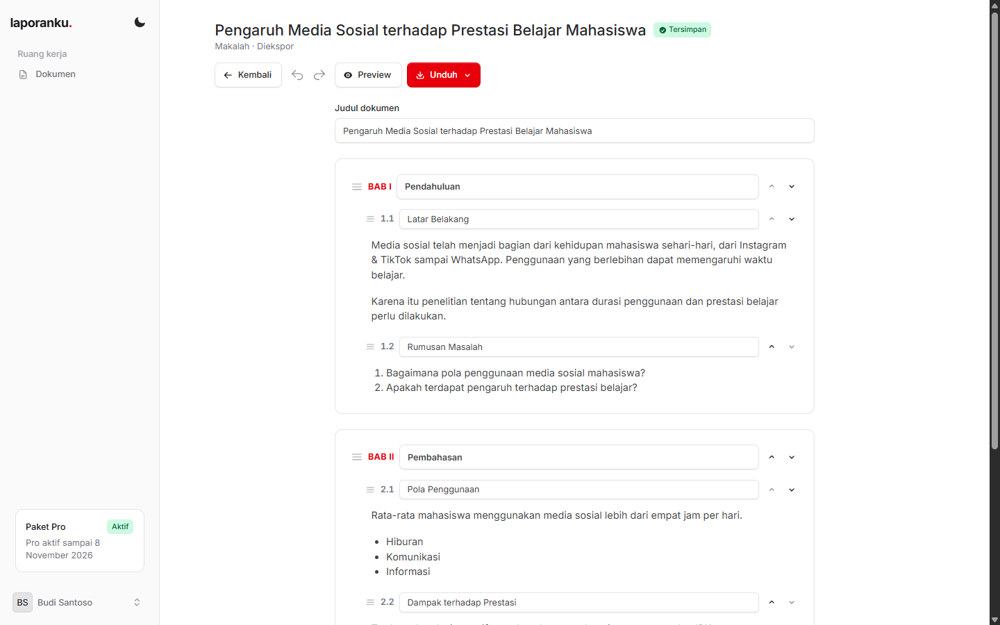</td>
  </tr>
  <tr>
    <td>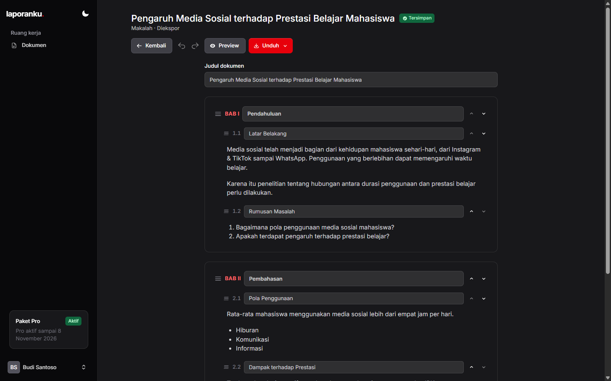</td>
    <td>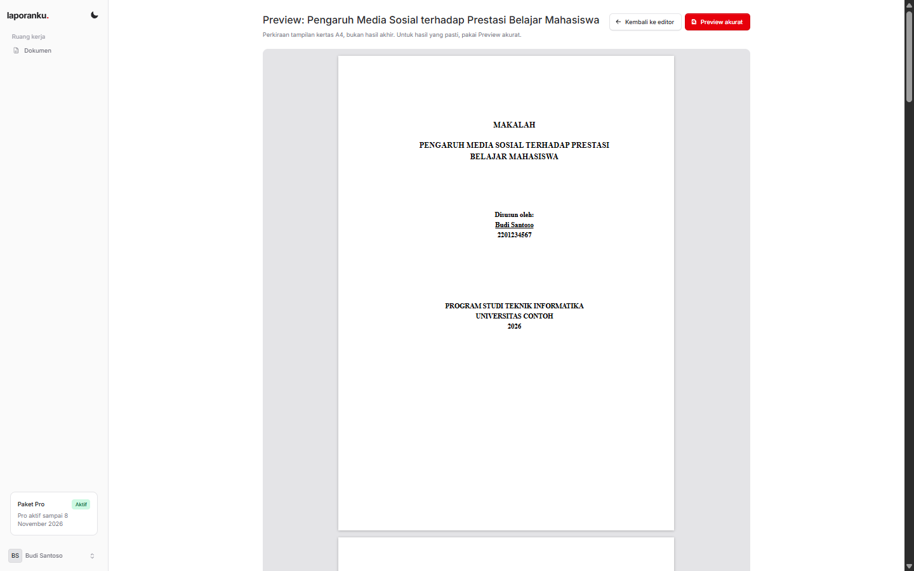</td>
  </tr>
  <tr>
    <td>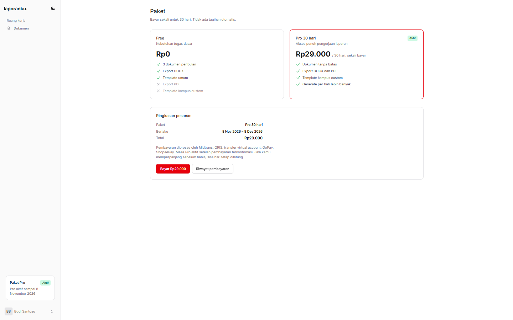</td>
    <td>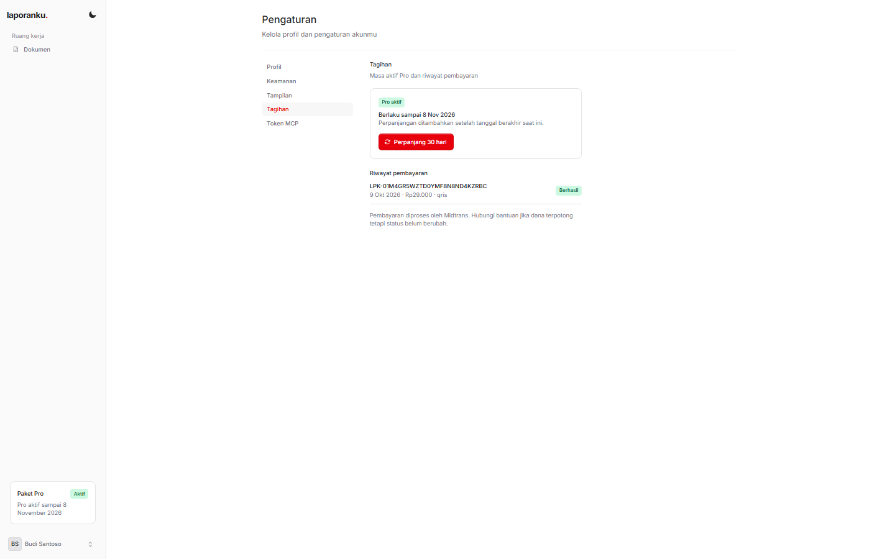</td>
  </tr>
  <tr>
    <td>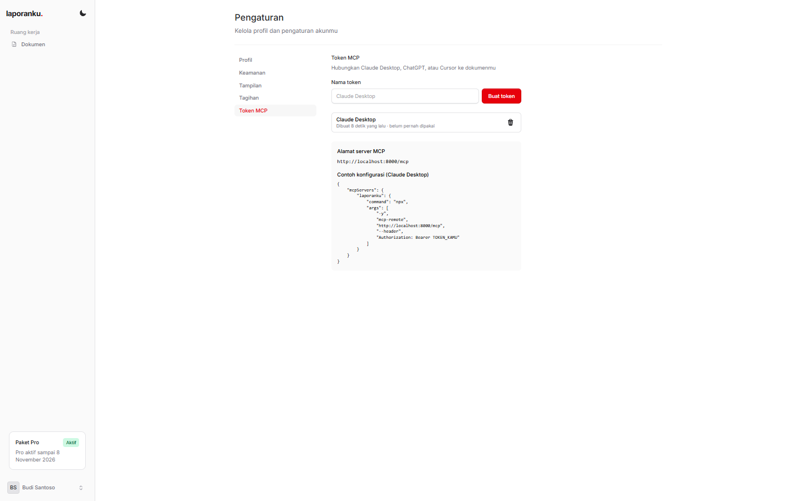</td>
    <td>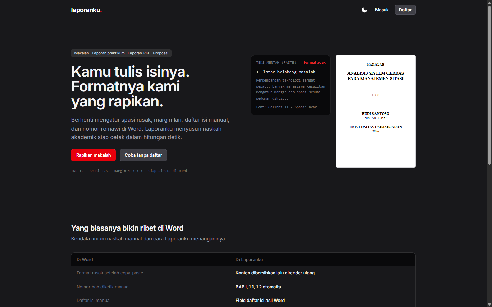</td>
  </tr>
</table>

## Tumpukan teknologi

- **Backend:** PHP 8.3+, Laravel 13, Livewire 4, Fortify, Sanctum
- **UI:** Flux UI (gratis), Tailwind CSS 4, Vite, Alpine.js
- **Editor dan preview:** TipTap 3, SortableJS, paged.js
- **Dokumen:** PHPWord (DOCX), Gotenberg 8 (PDF), `opis/json-schema` (validasi)
- **AI:** `laravel/ai` dengan OpenRouter, `laravel/mcp` untuk server MCP
- **Data:** PostgreSQL di Docker (SQLite untuk tes), antrean dan sesi dengan driver `database`
- **Pengujian:** Pest, PHPStan (Larastan), Pint
- **Pembayaran:** Midtrans Snap (sandbox)

## Arsitektur singkat

Logika inti ada di `app/Services`, bukan di komponen Livewire, supaya web dan MCP memakai kode yang sama.

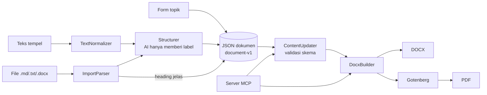

- Skema dokumen: [`resources/schemas/document-v1.json`](resources/schemas/document-v1.json). Satu skema dipakai untuk validasi server dan MCP.
- Status dokumen: `draft`, `structuring`, `ready`, `exported`.
- Penomoran bab dan subbab dihitung oleh builder, tidak disimpan di data.

## Server MCP

Agen AI bisa memakai Laporanku lewat MCP.

- **Endpoint:** `POST /mcp`
- **Autentikasi:** token pribadi (Sanctum) dari halaman **Pengaturan → Token MCP** (`/settings/tokens`). Akun tamu tidak bisa memakai MCP.
- **Tool:** `list-templates`, `create-document`, `get-document`, `update-chapter`, `export-document`
- **Ekspor:** mengembalikan tautan bertanda tangan berumur 10 menit, bukan isi berkas. PDF hanya untuk paket Pro.
- **Batas laju:** 60 permintaan per menit per token.

Contoh konfigurasi Claude Desktop (ganti `TOKEN_KAMU` dan alamat server):

```json
{
  "mcpServers": {
    "laporanku": {
      "command": "npx",
      "args": [
        "-y",
        "mcp-remote",
        "http://localhost:8000/mcp",
        "--header",
        "Authorization: Bearer TOKEN_KAMU"
      ]
    }
  }
}
```

## Menjalankan secara lokal

Prasyarat: Docker, Node.js, dan Composer (host hanya dipakai untuk build aset).

```bash
git clone git@github.com:zagoourai-hub/laopranku-project.git
cd laopranku-project

docker compose up -d                       # app :8000, PostgreSQL, antrean, Gotenberg :3002
cp .env.example .env                       # lalu isi nilai yang dibutuhkan
docker compose exec -T app php artisan key:generate
docker compose exec -T app php artisan migrate
npm install && npm run build               # di host, bukan di Docker
```

Buka <http://localhost:8000>. Semua perintah PHP dijalankan di dalam kontainer, dengan awalan `docker compose exec -T app`. Antrean berjalan di kontainer `queue`.

Alternatif tanpa Docker: `composer setup`, lalu `composer dev` (server, antrean, dan Vite). Untuk PDF tetap butuh Gotenberg yang bisa dijangkau lewat `GOTENBERG_URL`.

### Variabel lingkungan penting

Hanya nama variabel; **jangan** commit nilainya.

| Variabel | Fungsi |
|---|---|
| `APP_NAME`, `APP_URL` | Nama dan alamat aplikasi |
| `DB_*` | Koneksi database (PostgreSQL di Docker) |
| `GOTENBERG_URL` | Alamat Gotenberg untuk konversi PDF |
| `OPENROUTER_API_KEY` | Kunci OpenRouter untuk fitur AI |
| `AI_MODEL_STRUCTURE`, `AI_MODEL_OUTLINE`, `AI_MODEL_WRITE` | Model per tugas AI (pilihan final menunggu evaluasi) |
| `MIDTRANS_SERVER_KEY`, `MIDTRANS_CLIENT_KEY` | Kunci Midtrans **sandbox** |
| `MIDTRANS_IS_PRODUCTION` | Tetap `false` untuk sandbox |

Untuk mencoba pembayaran, isi kunci sandbox lalu arahkan *Payment Notification URL* di dashboard Midtrans ke `https://<url-publik>/midtrans/notification`. Aktivasi Pro hanya terjadi dari webhook yang lolos verifikasi, bukan dari callback browser.

## Pengujian

Tes memakai SQLite di memori, bukan PostgreSQL.

```bash
docker compose exec -T app php artisan test --compact
docker compose exec -T app vendor/bin/pint --test
docker compose exec -T app vendor/bin/phpstan analyse --memory-limit=1G
```

`composer test` menjalankan pembersihan konfigurasi, Pint, PHPStan, lalu seluruh tes. Panggilan AI dan Midtrans di tes memakai fake, tanpa jaringan.

## Struktur direktori

```
app/
  Actions/Fortify/      logika autentikasi
  Enums/                jenis dokumen, status, jenjang
  Jobs/                 StructureDocument
  Mcp/                  server dan tool MCP
  Models/  Policies/
  Services/
    Ai/                 Structurer, ParagraphLabeler
    Billing/            PlanLimits, MidtransService
    Documents/          ContentUpdater, DocxBuilder, PdfConverter, ImportParser, TextNormalizer, SchemaValidator
config/                 documents.php (template), plans.php, midtrans.php, ai.php
resources/
  schemas/              document-v1.json
  views/pages/          halaman Livewire (⚡*.blade.php)
routes/                 web, settings, billing, ai (MCP)
docs/                   PRD.md, desain Stitch, aset README
tests/                  Pest (Feature, Unit, Fixtures)
```

## Paket dan harga

| | Free | Pro |
|---|---|---|
| Dokumen | 3 per bulan (dokumen yang dihapus tetap terhitung) | Tidak dibatasi |
| Unduh DOCX | Ya | Ya |
| Unduh PDF dan Preview akurat | Tidak | Ya |
| Harga | Gratis | Rp29.000 per 30 hari (sekali bayar) |

Angka ada di [`config/plans.php`](config/plans.php). Template custom untuk Pro belum tersedia.

## Roadmap

1. Menyambungkan Structurer ke form tempel dan unggah, lalu outline yang bisa disetujui sebelum isi ditulis.
2. Penulisan per bab dengan progres, regenerasi bab, dan aturan referensi.
3. Evaluasi model pada 10 teks dan 5 prompt uji, lalu memilih model per tugas.
4. Format sitasi (APA/IEEE/Harvard), pencarian referensi asli, template custom kampus dan sekolah.
5. Deploy demo, Midtrans production, fitur AI tambahan.

Rincian dan urutan lengkap ada di PRD.

## Keamanan dan privasi

- Rahasia (kunci OpenRouter dan Midtrans) hanya di `.env`; `.env` tidak masuk git. Hanya client key Midtrans yang dikirim ke browser.
- Webhook Midtrans memeriksa `signature_key`, mengecek ulang status ke API Midtrans, dan idempotent per `order_id`.
- Dokumen hanya bisa diakses pemiliknya (policy). Tautan unduhan bertanda tangan dan berumur pendek.
- Teks pengguna dikirim ke penyedia model AI lewat OpenRouter. Kebijakan privasi, retensi data guest, dan penanganan pengguna di bawah 18 tahun masih berstatus terbuka di PRD.

## Kontribusi

Proyek ini belum menerima kontribusi eksternal secara resmi. Untuk bekerja di repo ini: ikuti [`AGENTS.md`](AGENTS.md) dan [`CLAUDE.md`](CLAUDE.md), jalankan Pint setelah mengubah PHP, tulis tes Pest untuk perubahan perilaku, dan tidak menambah dependensi baru tanpa persetujuan.

## Lisensi

Belum ditentukan.
